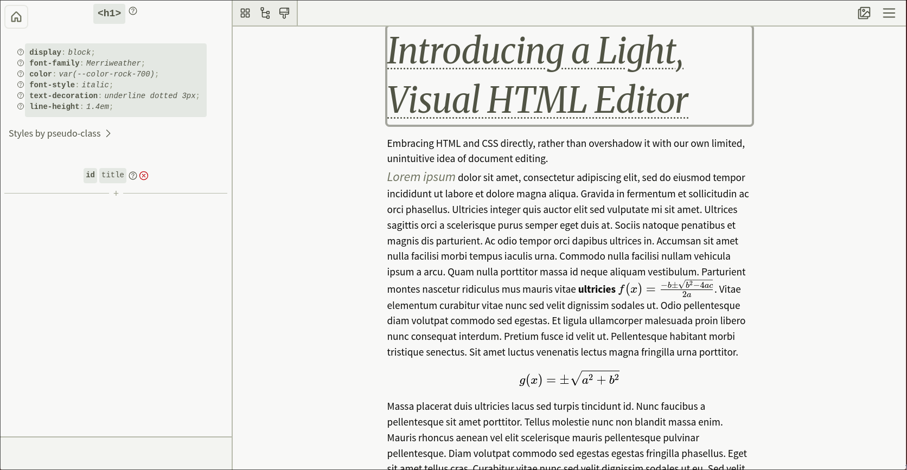

# svelte-html-document-editor

_A light, visual HTML document editor that embraces the use of HTML, CSS and Svelte directly._

[View the demo.](https://martinm07.github.io/document-editor/)



This project is intended to provide a powerful, and relatively approachable, way of editing HTML content, primarily for the purpose of writing article or blog content. By allowing full control over the HTML structure, attributes and CSS styles (and Svelte code for interactive elements), it surpasses the capabilities given by typical WYSIWYG editors, while trying to preserve ease-of-use.

## What It Is

- **Inspired by browser inspector tools and mode-based editors like Vim.**
- **What You See Is What You Get.** The editor, running in a browser environment, renders the HTML content you are writing, and the editor allows you to operate on that rendered content directly.
- **Open source and integratable.** Add the NPM package to your Svelte frontend and simply import and call `<DocumentEditor />` with the appropriate hooks.
- **By humans, for humans.** No 'AI coding agent' has touched the codebase, and every idea comes entirely from fleshy, squishy brain-matter.\
  I hope to offer some respite here, from the ever-increasing deluge of autogenerated noise. And I hope to create a tool which allows others to more completely express _their_ selves, which doesn't patronise its users, nor make assumptions about what they want.

## What It Has

- **Visual selection of HTML elements.** Hover elements in a document to show an outline. Press 'S' to toggle their selection. Multiple elements can be selected at a time.
- **Direct editing of CSS properties, HTML attributes and HTML tag names.** Select elements and see all of their relevant information in the editor sidebar. Any displayed information can also be directly modified.
- **Editing of any text in documents.** Hover over any text and press 'T' to immediately edit that text. (The editor achieves this through dynamic application of the `contenteditable` attribute).
- **Adding, moving and deleting of HTML elements.** Remove selected elements by pressing 'Del'. Add new elements by pressing 'A', then selecting the location you want to add it. Move selected elements by simply dragging them; the available destinations are displayed automatically.
- **Editing of global CSS stylesheet rules.** Toggle the sidebar's 'global styles' view to add, remove, edit and rearrange CSS rules to your heart's content.
- **Writing and integration of your own Svelte code into documents.** Write 'svelte-type components' through a built-in Svelte code editor, see their previews live, and mount them into your documents as you would regular HTML nodes.
- **A versioned component-library system.** Build your own collection of reusable HTML, CSS and Svelte snippets, and ensure consistency across all your documents (the component library is versioned, allowing updated to components to be propagated to documents).
- **A 'media tray'.** Collect and manage external files (like images) associated with a HTML document.
- **Built-in autocomplete and help links to MDN Web Docs.** Make writing your own HTML and CSS easier to deal with ;)
- **Full undo/redo support.** Use `Ctrl-Z`/`Ctrl-Y` on any action you take. The editor can store and _group_, as serializable objects, all arbitrary changes to the HTML content (i.e. not just those made using the editor's built-in tools). These history states, represented as lists of changes, can then be navigated in the familiar way. Even content not part of the document HTML string itself (such as document metadata, or global stylesheet rules) the editor secretly syncs to the HTML to allow undo/redo to work through the same mechanism.

## What It Doesn't Have (yet)

- A way to integrate into frontends that don't use Svelte.
- Any form of sanitization of the output.\
  <sup>It is **not safe** to embed the output of this editor when in the hands of _untrusted_ users (e.g. a forum site where users write posts using this editor), without doing your own validation beforehand. Otherwise you put your users at risk of HTML injection attacks!</sup>
- Support for keyboard-only workflows.
- Support for keyboardless workflows.
- Complete documentation.
- ...Things not listed as "Done" on [this Fizzy board](https://app.fizzy.do/6240055/public/boards/KZhFtuY3SEJMdZYEiSuJ3k6L).

## Usage

This project defines a Svelte component that can be imported and used inside frontends written in Svelte. It expects you to provide various hooks to allow it to integrate with the rest of your website or application. And it largely expects to have the page for itself (given it creates its own sidebar and navbar UI spanning the screen's full height and width).

To install, run:

```sh
npm install svelte-html-document-editor
```

Then use it as so in a `.svelte` file:

```svelte
<script lang="ts">
	import { DocumentEditor, type EditorState } from 'svelte-html-document-editor';

	const editorState: EditorState = $state({
		mode: 'document',
		resourceName: '1',
		documentRedirect: null
	});

	const metaInputFields = {/* [...] */};
</script>

<DocumentEditor
	{editorState}
	{metaInputFields}
	doChangePage={() => undefined}
	doFullSync={() => undefined}
	doPatchSync={() => undefined}
	doMediaUpload={() => ({
		cancelUpload: () => undefined,
		getFilepath: () => ''
	})}
	doMediaRemove={() => undefined}
	doPublish={() => undefined}
	doCompLibUpdate={() => undefined}
	getDoc={() => ({
		id: '1',
		body: '',
		stylesheet: '',
		compLibVer: ''
	})}
	getLatestCompLibVersion={() => ''}
	getCompLib={() => []}
	getAllUploadedMedia={() => []}
/>
```

A more complete example can be found in [src/routes/+page.svelte](./src/routes/+page.svelte).\
If you want to run _that_ demo page locally, do the following:

```sh
git clone git@github.com:martinm07/document-editor.git
cd document-editor
npm install
npm run dev
```

## Contributing

Feel free to reach out if your interest has been piqued— don't be a stranger :-)

## License

[GPL-3.0](./LICENSE)
